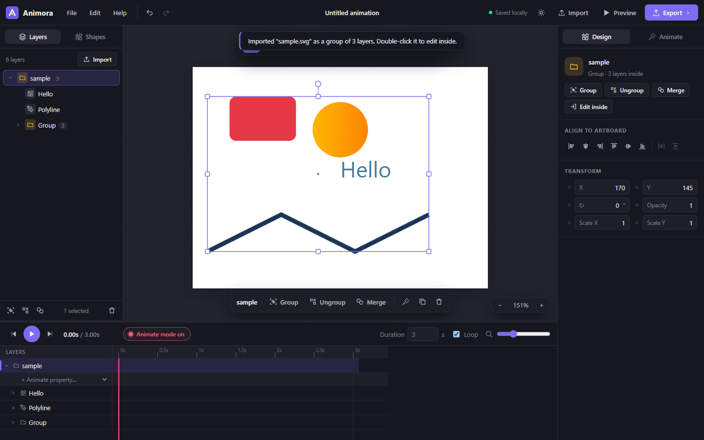

# Animora: open-source SVG animator

**Animora** is a free, open-source SVG animation editor that runs entirely in your browser, in the spirit of
[SVGator](https://www.svgator.com/). **No sign-up, no sign-in, no uploads.** Your work stays on your machine.

Draw or import vector artwork, animate it on a keyframe timeline with easing, and export a lightweight
**animated SVG** that plays anywhere without JavaScript. You can also export a WebM video or PNG frames.

### ▶ [Open Animora in your browser: itsrajverma.github.io/animora](https://itsrajverma.github.io/animora/)

Nothing to install and no account to create. Open the link and start animating.

[](https://github.com/itsrajverma/animora/actions/workflows/deploy.yml)
[](LICENSE)



## Features

**Layers, groups & merging**
- Layers panel with nested **groups**: drag layers to reorder or drop them *into* groups
- **Group** (Ctrl+G), **Ungroup** (Ctrl+Shift+G) and **Merge into one shape** (Ctrl+E). Transforms are rebased, so nothing jumps
- Double-click a group to edit the layers inside it (Ctrl+click selects deep layers directly); groups can be animated too
- Imported SVGs keep their original group hierarchy, wrapped in one group named after the file
- Right-click menu, floating selection bar, align & distribute

**Drawing & editing**
- Floating tool dock: rectangle, ellipse, line, star, polygon, pen (straight + Bézier curves) and text
- Built-in shape library (heart, arrow, bubble, bolt, ring, check mark…)
- Select, move, resize (Shift = keep ratio, Alt = from center), rotate (Shift = 15° steps), marquee select
- Node editing for paths (double-click a shape), convert shapes to paths
- Layers in the timeline: rename, reorder by drag & drop, hide, lock
- Align to artboard, z-order, duplicate, copy/paste, undo/redo, keyboard shortcuts
- Zoom & pan (Ctrl + wheel, wheel, middle mouse, hand tool); dark and light themes

**Animation**
- Keyframe timeline per property: position, rotation, scale, opacity, fill, stroke, stroke width,
  width/height, corner radius, font size, **path morphing** and **stroke drawing (trim path)**
- **Animate mode**: change anything at the playhead and keyframes are created automatically
- 30+ easing presets (sine, cubic, expo, back, bounce, elastic…) plus a draggable **custom cubic-bezier** editor
- Drag keyframes to retime them (snaps to the playhead), multi-select with Shift
- Shape morphing between any paths, including different point counts (paths are normalized automatically)
- One-click presets: fade, pop, slide, bounce, spin, pulse, shake, draw stroke
- Loop or play once; adjustable duration

**Import / export**
- Import SVG files (CSS classes, group transforms, gradients and clip paths are preserved) and PNG/JPG/GIF/WebP images
- Drag & drop files onto the window
- Export **animated SVG** (SMIL: no JS, works in `` tags and CSS backgrounds)
- Export **WebM video**, **PNG** frame (2×), static SVG frame
- Save/open project files (`.animora.json`); automatic local save in the browser

## Run it locally

Just want to use it? Go to **https://itsrajverma.github.io/animora/**. To run or develop it on your own machine:

```bash
git clone https://github.com/itsrajverma/animora.git
cd animora
npm install
npm run dev
```

Open http://localhost:5173. To build a static site (deployable to any static host, e.g. GitHub Pages or Netlify):

```bash
npm run build   # output in dist/
```

A GitHub Actions workflow (`.github/workflows/deploy.yml`) publishes `dist/` to GitHub Pages on every push to `main`.

## How animating works

1. Draw a shape or import an SVG.
2. Leave **Animate mode** on (the red button in the timeline).
3. Move the playhead, then move, scale, rotate or recolor the shape. A keyframe appears for each changed property.
4. Click a keyframe diamond to jump to it, then pick its easing (the easing applies from that keyframe to the next).
5. Click **Preview & Export** to see the standalone file and download it.

For morphing: convert a shape to a path, move the playhead, then either edit its nodes or use **Morph into** to
take the shape of another layer.

## Keyboard shortcuts

| Key | Action |
| --- | --- |
| V / A / H | Select / edit nodes / pan |
| R / E / L / S / G / P / T | Rectangle / ellipse / line / star / polygon / pen / text |
| Space | Play / pause |
| Home / End, `,` / `.` | Jump to start / end, previous / next frame |
| Delete | Delete selected layers or keyframes |
| Ctrl+Z / Ctrl+Shift+Z | Undo / redo |
| Ctrl+C / X / V / D | Copy / cut / paste / duplicate |
| Ctrl+G / Ctrl+Shift+G | Group / ungroup |
| Ctrl+E | Merge selection into one shape |
| Enter / Esc | Enter a selected group / leave it |
| Arrows (+Shift) | Nudge 1px (10px) |
| Ctrl+S / Ctrl+O / Ctrl+I / Ctrl+Shift+E | Save project / open / import / export SVG |
| Ctrl+0 | Fit artboard to screen |

## Architecture

Vite + React 18 + TypeScript, with Zustand + Immer for state. No backend.

- One renderer (`src/engine/render.ts`) is used for the editor canvas, frame exports and the animated SVG, so what you see is what you export.
- Animated export uses nested `<g>` wrappers with `<animateTransform>` per transform channel and
  `<animate>` per attribute, with `calcMode="spline"` key splines for easing. Easings that overshoot (back, elastic,
  bounce) are sampled, since SMIL key splines must stay in [0, 1].

See [CONTRIBUTING.md](CONTRIBUTING.md) for a code map.

## Roadmap ideas

- Masks and boolean operations (union / subtract)
- Gradient editing, filters (blur, shadow)
- Motion paths (move along a path)
- CSS / JavaScript-player export options, Lottie export, GIF export
- Interactive triggers (play on hover / click / scroll)

Contributions welcome!

## License

[MIT](LICENSE)
